## Configuration de l'expérience

- Dataset : GTSRB, 43 catégories, 26 640 images
- Découpage : 60 % entraînement / 20 % validation / 20 % test (`stratify`, `random_state=42`)
- Taille des images : 30×30 / 60×60
- Optimiseur : Adam, perte : `categorical_crossentropy`, taille de lot : 32
- Nombre d'époques : 10

## Remarques 
Remarques générale : 
Que les Images soit en 30x30 ou en 60x60, dans les deux premières époques la perte est élévée mais plus les époques continues plus elle baisse, de même que la accurracy est basse plus on avance elle se rapproche de 1.

Reponses aux questions :

Je peux pas faire plus de 3 blocks de Conv2D et MaxPooling2D sinon j'ai un crash (32, 64, 96 ou 32, 64, 128)
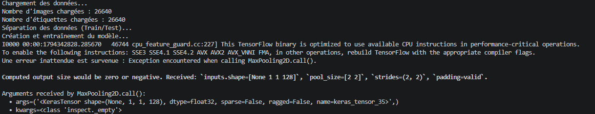

Les test éffectué sont avec TEST_SIZE de 0.2, soit 80% = 21 312 images pour l'entraînement (x_train, y_train) et 20% = 5 328 images pour les test(x_test, y_test)

J'ai fait 16 tests au total :

Image 1-4  : 30×30, 2 Conv2D (32, 64)
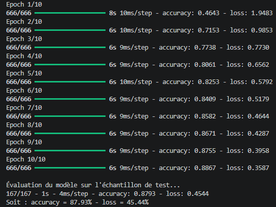
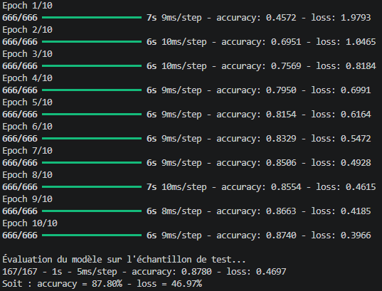
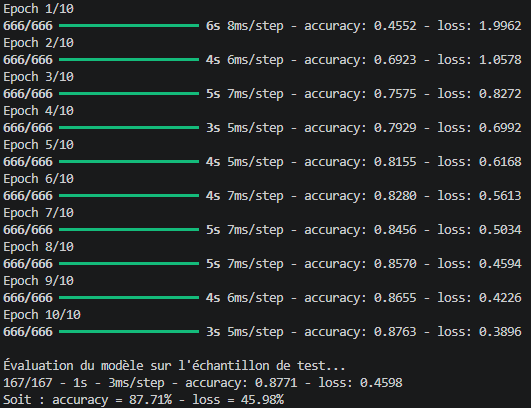
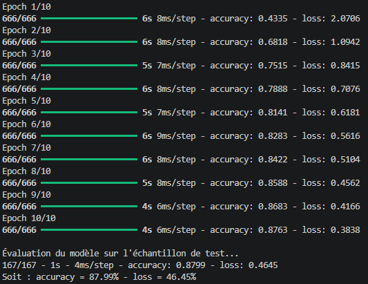

Image 5-8  : 30×30, 3 Conv2D (32, 64, 96)
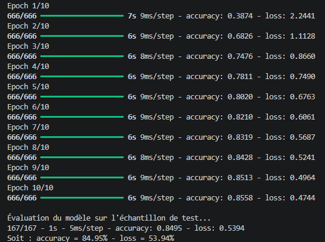
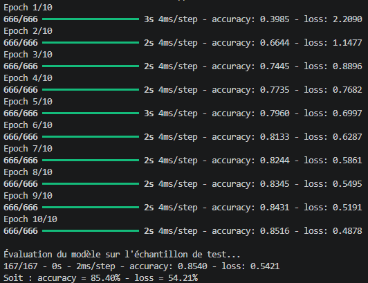
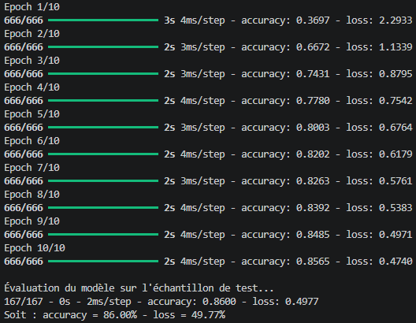
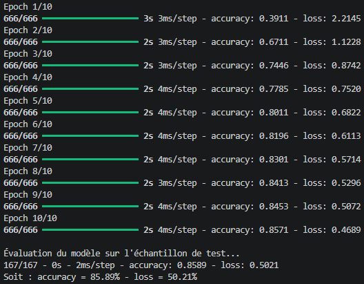

Image 9-12 : 60×60, 2 Conv2D (32, 64)
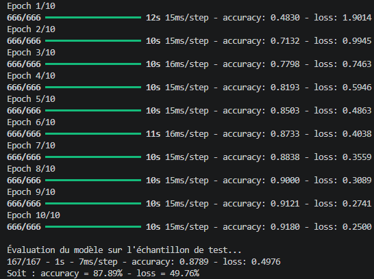
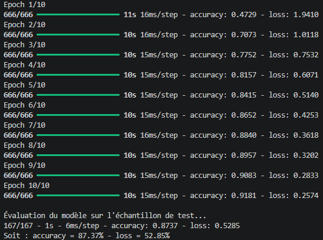
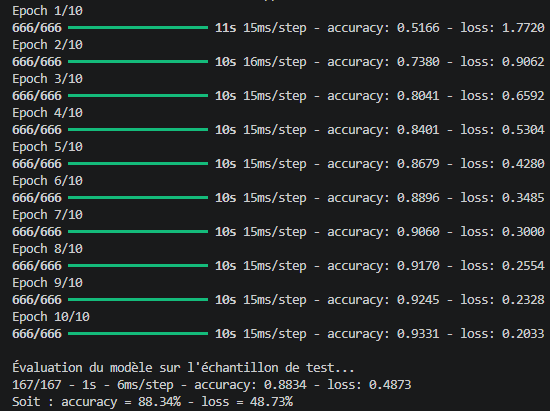
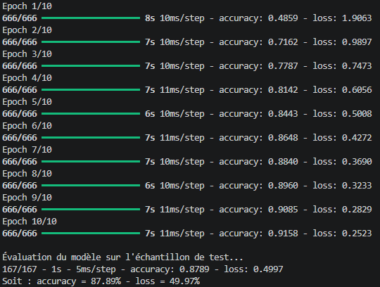

Image 13-16: 60×60, 3 Conv2D (32, 64, 96)

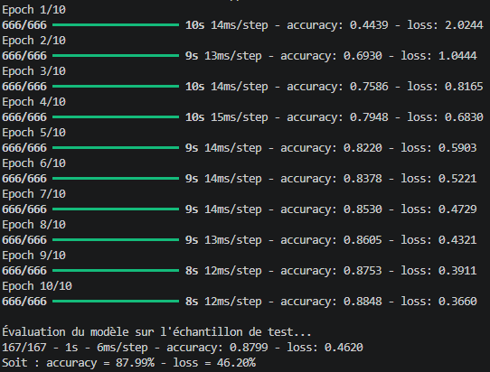
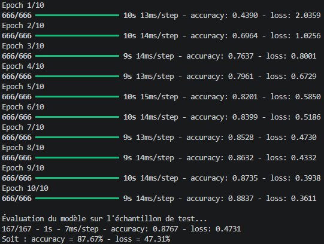
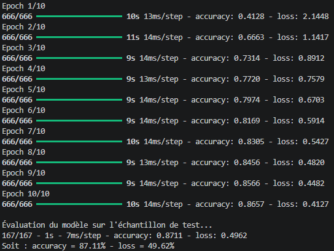

## - Architecture de mon CNN (de base avec un deux conv2D)
Couche	                            Sortie (30×30)	            Paramètres	        Rôle
Input	                            30×30×3	                    0	                Image RGB normalisée entre 0 et 1
Conv2D (32 filtres, 3×3, Relu) 	    28×28×32	                896	                Regarde les Motifs simples (bords, couleurs)
MaxPooling2D (2×2)	                14×14×32	                0	                Réduit la taille de moitié
Conv2D (64 filtres, 3×3, Relu)     	12×12×64	                18 496	            Regarde les Motifs plus complexes (formes, textures)
MaxPooling2D (2×2)	                6×6×64	                    0	                Réduit la taille de moitié
Flatten	                            2 304	                    0	                Prépare les couches denses
Dense (128, Relu) 	                128	                        295 040	            Combine les motifs détectés
Dropout (0,5)	                    128	                        0	                Régularisation on utilise que 50% des neuronnes
Dense (43, softmax)	                43	                        5 547	            Probabilité par catégorie
Total		                                                    319 979

## - Y a-t-il eu du surapprentissage ?

Pour 60×60 avec 2 blocs de conv2D : environ 92 % à l’entraînement contre 88 % au test, sur toute la série. C’est du surapprentissage, et le dropout de 0,5 ne l’empêche pas.

Pour 30×30 avec 2 blocs de conv2D : entraînement et test identiques (≈ 88 %). Pas de surapprentissage, le modèle est plutôt limité ou pas assez entraîné.

Pour 30×30 avec 3 blocs de conv2D : 85,5 % à l'entraîement et au test, il sous-apprend.

## - Quel est l’impact d’imposer une taille fixe de 30×30 à toutes les images sur les capacités d’apprentissage de votre réseau ?

Lorsque je regardes mes tests avec deux conv2D lorsque la taille est fixé à 30x30 ou et avec 3 conv2D lorsque la taille est fixé à 60x60 : Le accurary reste constant sur mes 4 tests. Il est sensiblement égale au valeur de l'entraînement.

Aussi lorsque je faisais mes tests j'ai remarqué que lorsque mon ordi est branché le test est plus rapide contrairement à lorsqu'il est branché. J'ai voulu voir si le cela influençais mes résultats au niveau de mon surapprentissage détecté plutôt mais c'était pas le cas.

## - Autres test à faire
Augmenter le TEST_SIZE, le nombre d'époque ou le DROPOUT : pourrait changer les valeurs.